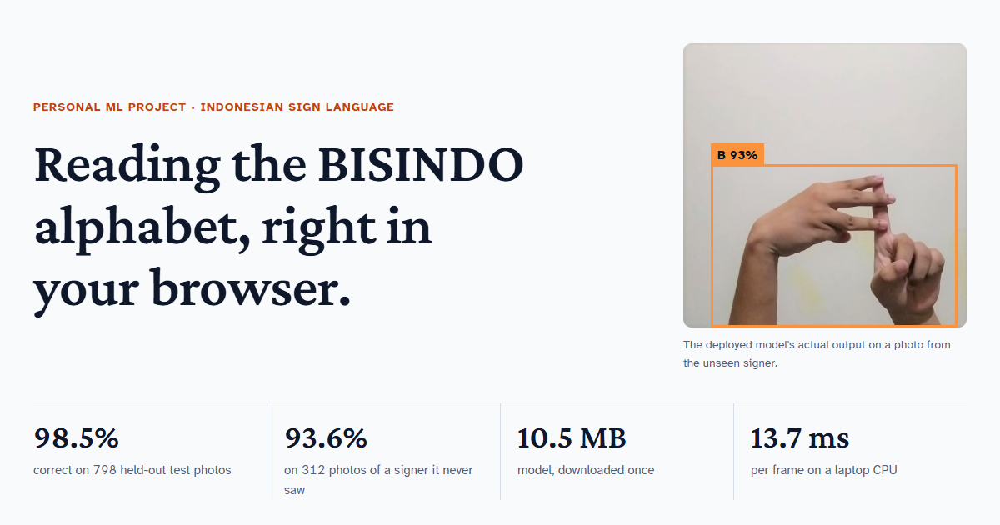

# BISINDO Fingerspelling

Recognises all 26 letters of the Indonesian Sign Language (BISINDO) alphabet, as still handshapes, from a webcam frame,
entirely in the browser. A 2.6M-parameter YOLO11n detector is exported to ONNX and run client-side with
ONNX Runtime Web, so no video leaves the device.

**Live demo:** https://daendells.github.io/bisindo/



## Results

One answer per photo (the most confident box); a photo with no box counts as wrong.

| Set | Photos | Top-1 accuracy | Macro-F1 | Role |
|---|---:|---:|---:|---|
| Validation | 1,194 | 98.7% | 0.988 | used to choose the model |
| Held-out test | 798 | 98.5% | 0.986 | scored once, after the choice |
| Unseen signer | 312 | 93.6% | 0.919 | a different person and backgrounds (CC0) |

What the numbers say:

- **The public dataset leaked.** 62.9% of its validation photos were near-copies of training photos
  (perceptual-hash distance ≤ 6), because augmentation was applied before the split. YOLO11n at 320 px scored
  mAP50-95 0.923 on that split and 0.840 after re-splitting by hash groups, where near-copies fell to 0.75%.
- **Errors on a new signer sit on two letters.** All 20 mistakes on the unseen signer are on O (0/12 right) and Y (4/12); the other 24 letters are 288/288. This signer forms O with the thumb and index finger only,
  a variant the training data does not contain.
- **The one tuning experiment was a tie.** 416 px input beat 320 px by 1 validation photo (1,178 vs 1,177 of 1,194; M/N mix-ups 8 → 7) and lost by 3 on the unseen signer (292 vs 295 of 312). It ships because a rule fixed before the run said validation decides; gaps of a few photos are noise.
- **The detector beats the cheaper alternatives** on the same splits and protocol:

| Model | Validation | Unseen signer | ONNX size | CPU ms / frame |
|---|---:|---:|---:|---:|
| **YOLO11n · 416 px (in the demo)** | 98.7% | 93.6% | 10.5 MB | 13.7 |
| YOLO11n · 320 px | 98.6% | 94.6% | 10.5 MB | 9.8 |
| YOLOv8n · 320 px | 98.5% | 93.3% | 12.2 MB | 9.6 |
| Hand landmarks + SVM | 77.3% | 81.7% | — | — |
| DINOv2 ViT-S/14 + SVM | 87.4% | 92.3% | — | — |

CPU timings: median of 50 runs, ONNX Runtime, Intel i5-11400H. The landmark baseline tracks one hand per photo,
while many BISINDO letters use two.

## How it works

1. **Audit** the raw data (`audit_dataset.py`, `check_cross_dup.py`, `check_near_dup.py`): duplicates,
   unlabeled images and train/validation copies.
2. **Split by group** (`make_group_splits.py`): cluster by pHash, assign whole groups to train / val / test
   (7,963 / 1,194 / 798), stratified by letter.
3. **Train** (`train.py` + `configs/*.yaml`): YOLO11n from COCO weights, 50 epochs, AdamW, cosine LR, mild
   augmentation, horizontal flip off (a mirrored sign is not guaranteed to be the same letter).
4. **Choose on validation, test once** (`evaluate.py`, `evaluate_holdout.py`).
5. **Export and publish** (`build_site_data.py`): ONNX model, `docs/results.json` (every number on the page)
   and the sample photos.
6. **Run in the browser** (`docs/app.js`): letterbox like Ultralytics, run the ONNX model with WebAssembly, take
   the most confident box, vote over the last 8 frames, type a letter that wins 6 of them at ≥ 60% confidence
   and stays steady for a second.

## Repository

```text
configs/        training configs (yolo11n.yaml = baseline, yolo11n_416.yaml = the one experiment, yolov8n.yaml)
data/splits/    file lists for each split (v1 = original leaky split, v2 = group split used here)
data/reports/   audit reports
docs/           the website (GitHub Pages): index.html, app.js, style.css, results.json, model/, samples/
index.html      forwards to docs/ when GitHub Pages publishes the repository root instead of /docs
experiments/    runs.csv and per-image predictions behind every reported number
scripts/        audit, split, train, evaluate, export, and the two baselines
tests/          unit tests for the metric rules (top-1, macro-F1, confidence threshold)
```

## Reproduce

```bash
pip install -r requirements.txt            # install PyTorch for your CUDA first
# download the training data into data/raw/  (images/{train,val}/<letter>/, labels/...)
# download the unseen-signer set into data/holdout_achmadnoer/
python scripts/audit_dataset.py
python scripts/make_group_splits.py
python scripts/train.py --config configs/yolo11n.yaml
python scripts/evaluate.py --weights checkpoints/<run>/weights/best.pt              # validation
python scripts/evaluate.py --weights checkpoints/<run>/weights/best.pt --split test # once, at the end
python scripts/evaluate_holdout.py --weights checkpoints/<run>/weights/best.pt
python scripts/build_site_data.py --model <run>
python -m http.server --directory docs     # open http://localhost:8000
python -m unittest discover -s tests       # the metric rules behind every number
```

Trained on an RTX 3050 Laptop (4 GB) with batch 4; a 50-epoch run takes about two hours.

## Limits

- Still handshapes only, one letter at a time; no words, numbers or movement.
- The training photos come from a small group of signers against plain walls, so handshape variants from
  other signers fail (see O and Y).
- Not a translation tool, and not evaluated with Deaf signers.

## Data and licence

- Training data: [Indonesian Sign Language (BISINDO)](https://www.kaggle.com/datasets/agungmrf/indonesian-sign-language-bisindo)
  by agungmrf on Kaggle. No licence is stated, so the images are not redistributed here.
- Unseen-signer set: [Alfabet BISINDO](https://www.kaggle.com/datasets/achmadnoer/alfabet-bisindo) by achmadnoer
  on Kaggle, CC0. The sample photos in `docs/samples/` come from it.
- Code and model: [AGPL-3.0](LICENSE), matching [Ultralytics YOLO](https://github.com/ultralytics/ultralytics),
  whose pretrained weights the model is fine-tuned from.

Built by [Davin Jonathan Tanus](https://portofolio-liard-ten.vercel.app/).
